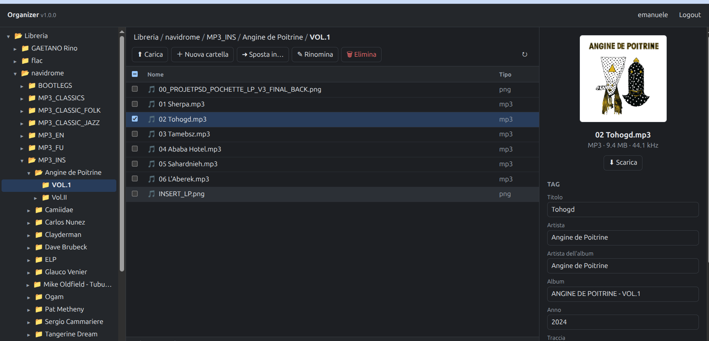

# Organizer

Web app to organize a music library on a server: browse folders, edit audio tags and covers, listen to tracks, preview images and text files, and move, rename, upload or delete files. It also manages users and their permissions.



## Features

- **Three-pane file browser**: folder tree, file list, details panel. Multi-select with Ctrl/Shift-click, keyboard navigation, drag & drop to move files, drag files from your computer to upload.
- **Audio tags**: edit title, artist, album artist, album, year, track and genre for one file or many at once (including whole folders); embed cover images in MP3s.
- **Player**: double-click a track to play it; the player keeps going while you browse and moves on to the next track of the folder.
- **Previews**: images (with size and dimensions, and one click to use them as the album cover) and text files such as `.nfo`, `.cue`, `.m3u`, `.txt`.
- **File operations**: upload, create folders, move, rename, delete, convert FLAC to MP3 (320 kbps, via ffmpeg).
- **Users and permissions**: read / write / admin roles, user management page, password change.

Built with Next.js and React; tags are read with `music-metadata` and written with `node-id3`. No database: users live in a JSON file.

## Running locally

Requirements: Node.js 24, and `ffmpeg` on the `PATH` if you want FLAC → MP3 conversion.

```bash
npm install
cat > .env.local <<'ENV'
TARGET_DIR=/path/to/your/music
AUTH_SECRET=any-long-random-string
ENV
npm run dev
```

Open <http://localhost:3000>. On the first run there are no users: go to `/signup` and create the first account, which becomes an administrator.

## Running with Docker

Every push to `main` builds and publishes the image `paolini/organizer`, tagged with the version in `package.json` and with `latest`. The image includes ffmpeg.

A minimal `docker-compose.yml` (also in this repository):

```yaml
services:
  organizer:
    image: paolini/organizer:1.0.0
    restart: unless-stopped
    environment:
      - TARGET_DIR=/target
      - AUTH_SECRET=${AUTH_SECRET}
    ports:
      - "3000:3000"
    volumes:
      - /path/to/your/music:/target:rw   # the music library
      - ./data:/app/data:rw              # users.json lives here
```

Put `AUTH_SECRET=<a long random string>` in a `.env` file next to the compose file, then `docker compose up -d`.

To upgrade, change the image tag and run `docker compose pull && docker compose up -d`. The users in `./data` are kept.

The app speaks plain HTTP: in production put it behind a reverse proxy that terminates HTTPS (for example Traefik or Caddy) and sets `X-Forwarded-For`.

## Authentication and users

Users live in `data/users.json` (a JSON array; passwords are bcrypt hashes). Sessions are JWTs signed with `AUTH_SECRET`, stored in an HTTP-only cookie named `token` and valid for 7 days.

### Permissions

| Permission | Allows |
|---|---|
| `read`  | browse files and tags, download |
| `write` | edit tags and covers, upload, move, rename, delete, convert |
| `admin` | manage users (the **Utenti** page) |

### Managing users

- **First user**: on an installation with no users, `/signup` creates the first account with all permissions (`read`, `write`, `admin`).
- **Afterwards**, admins manage everything from the **Utenti** page (`/users`): create users, toggle permissions, reset passwords, delete users. An admin cannot remove their own `admin` permission or delete themselves, so at least one admin always remains.
- **Every user** can change their own password from the account page (`/account`).
- Changing or resetting a password logs out every other session of that user. Deleting a user ends their sessions immediately.
- Passwords must be at least 8 characters.

### Environment variables

- `TARGET_DIR` — root folder of the music library. Example: `/home/you/mp3`.
- `AUTH_SECRET` — secret used to sign session tokens. **Always set it in production.**
- `ALLOW_SIGNUP` — set to `true` to let anyone register from `/signup`. New accounts get no permissions until an admin enables them. Default: registration closed (except for the very first user).

### Security notes

- After 10 failed logins from the same IP within 15 minutes, further attempts from that IP are refused for the rest of the window. The client IP is read from `X-Forwarded-For`, so the app must run behind a reverse proxy that sets that header (such as Traefik).
- `data/users.json` contains password hashes: never commit it (it is in `.gitignore`).

### Recovering access manually

If no admin can log in, edit `data/users.json` directly: add `"admin"` to a user's `permissions`, or replace their `password` with a new bcrypt hash, for example:

```bash
node -e "console.log(require('bcryptjs').hashSync(process.argv[1], 10))" 'new-password'
```

Changes to the file take effect immediately, without restarting.
